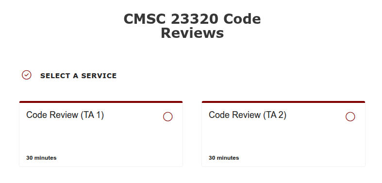
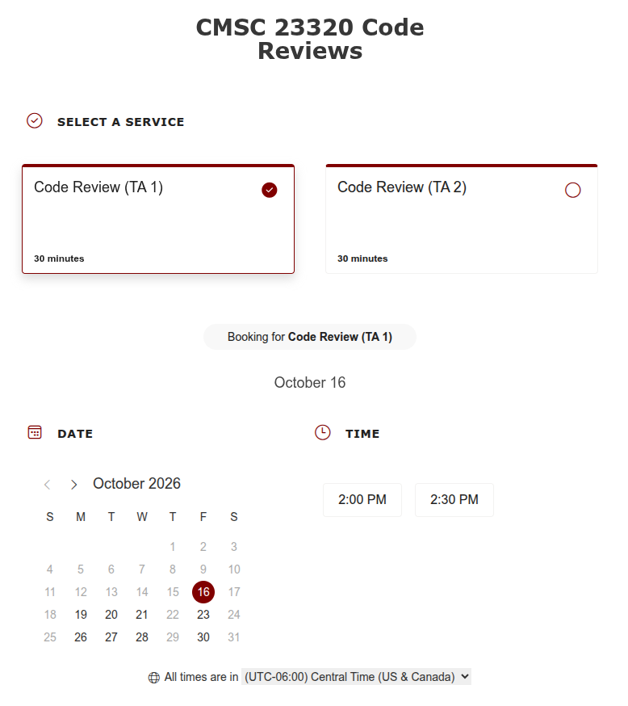
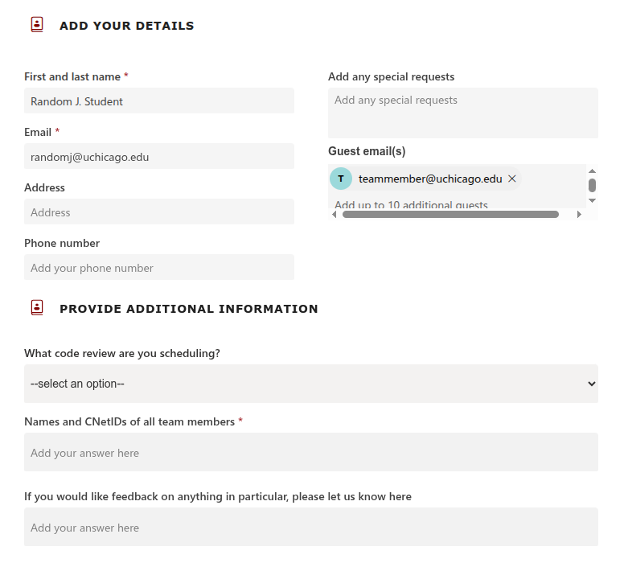

Code Review Scheduling Instructions
-----------------------------------

To schedule a code review, you must use the **Booking URL**
that will be provided on Canvas. When clicking on the Booking
URL, you may be asked to log in; make sure you do so with your
UChicago e-mail address (``CNETID@uchicago.edu``).

Please note that, while both members of the team must attend
each code review, only one team member should book the appointment
(you will be able to specify who your project partner is when
making an appointment).

On the booking page, you will be able to choose a TA to
make an appointment with:

You **must** select the TA you have been assigned to
(you can find this information in the ``code-review.txt``
file we have pushed to your team repository).

Once you click on a specific TA, you will be able to
select a specific time and date:

Please note that you must book appointments at least
24 hours in advance. If none of the times work for you,
please reach out to your TA to find an alternate time.

Next, you will add a number of details:

Please make sure to enter the following information:

- **First and last name**.
- **Email**: Enter your UChicago e-mail address (``CNETID@uchicago.edu``).
- **Guest email(s)**: Enter the UChicago e-mail address
  of your project partner (``CNETID@uchicago.edu``).
- You *do not* need to enter an Address or Phone Number.

Under "Provide Additional Information", you must select
the specific code review you are signing up for, and enter
the names and CNetIDs of all the team members. There is also
an optional field where you can specify whether you want feedback
on anything in particular.
